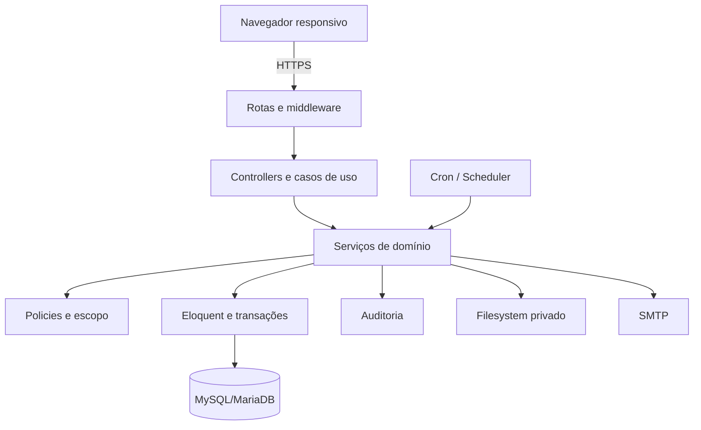

# Arquitetura

## Contexto

O JUDOMA é um monólito modular Laravel, renderizado no servidor e implantável em hospedagem Linux comum. O identificador técnico legado `SIGAM` permanece em comandos, variáveis, bancos e nomes de infraestrutura para preservar compatibilidade. MySQL/MariaDB é a fonte de verdade; arquivos privados, SMTP e scheduler via cron são serviços laterais.

## Limites

- `IdentityAccess`: autenticação, usuário ativo, papéis, permissões, associação atual, convite de professor e recuperação de senha.
- `Organization`: associação, dojos e vínculos institucionais.
- `People`: cadastro central sem duplicação por papel.
- `SportsRegistry`: aluno, responsável, professor, modalidade e graduação.
- `Classes`: turma, agenda, matrícula, aula e presença.
- `Progression`: catálogo de técnicas, currículo por graduação, avaliação técnica, técnicas da aula, quiz, painéis e lembrete (ADR-014); lê `SportsRegistry` e `Attendance`.
- `Documents`: upload/download privado e validade.
- `Finance`: plano, benefício, cobrança, pagamento e estorno.
- `Federation`: catálogo federativo, filiações históricas e documentos vinculados; lê `SportsRegistry` e `Documents`.
- `Championship`: eventos, inscrições, decisão, resultados e projeção por leitura no histórico; usa `Finance` para cobrança/pagamento.
- `Portal`: leituras pessoais e de dependentes; escrita limitada de contatos e inscrição delegada a `Championship`.
- `Notification`: eventos idempotentes, caixa interna e fila SMTP em lotes.
- `Reporting`: agregações por escopo sem manter uma segunda fonte de verdade.
- `Import`: arquivo privado, prévia durável e aplicação delegada a `SportsRegistry`/`Classes`.
- `AuditOperations`: trilha imutável, preflight e rotinas de consistência operacional.

### Consolidação associação/dojo

`Access\OperationalScope` continua sendo a porta de entrada do contexto local. `DojoFinanceController` e `DojoChampionshipController` só coordenam HTTP e consultam dados já filtrados por associação e dojo; regras críticas permanecem em `FinancialBenefitService`, `RecurringChargeService`, `PaymentService` e `ChampionshipRegistrationService`, sob transação. A associação mantém os catálogos de planos e campeonatos. O dojo apenas vincula plano a aluno regular, opera sua cobrança/etapa de gratuidade e cria inscrição no evento central. `student_plans.dojo_id` e `championship_registrations.dojo_id` são as origens persistidas; `primary_dojo_id` não é autorização nem fonte financeira.

## Fluxo obrigatório de uma escrita crítica

`rota → middleware de autenticação/permissão/contexto → Form Request → controller fino → serviço de domínio → transação/locks → models/constraints → auditoria`.

Controllers não devem implementar transições de estado, confiar em `association_id`/`dojo_id` recebidos nem escrever lançamentos críticos diretamente. Jobs chamam os mesmos serviços do fluxo HTTP e precisam continuar idempotentes. Consulte `MAINTENANCE_GUIDE.md` para o mapa de código e o procedimento de mudança.

Form Requests validam formato, mas não provam autorização. Serviços de domínio protegem invariantes; middleware/Policies/Gates autorizam; banco reforça integridade com FKs, índices e constraints.

## Decisão multiassociação inicial

O banco contém `association_id` desde a fundação. Na primeira experiência, o usuário comum opera em uma associação atual derivada da conta. Papéis globais podem ter associação nula. Troca de associação e SaaS público dependem da decisão D-01.
