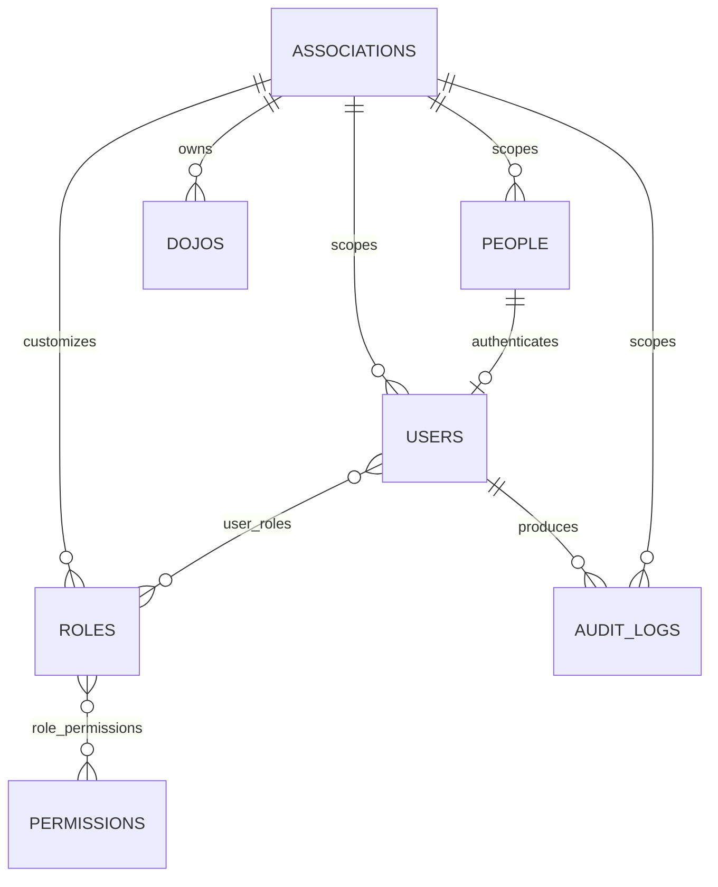
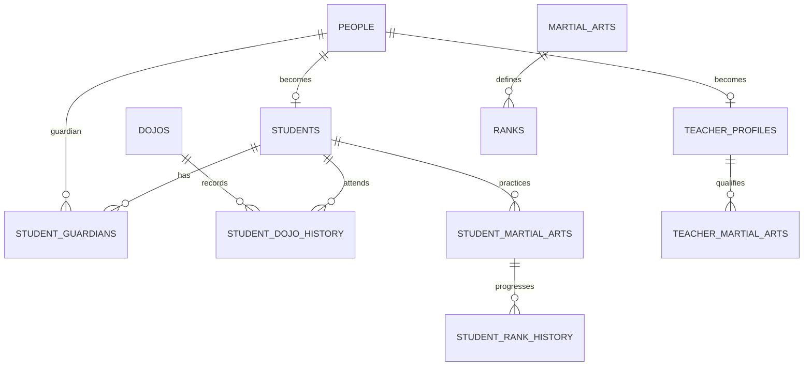
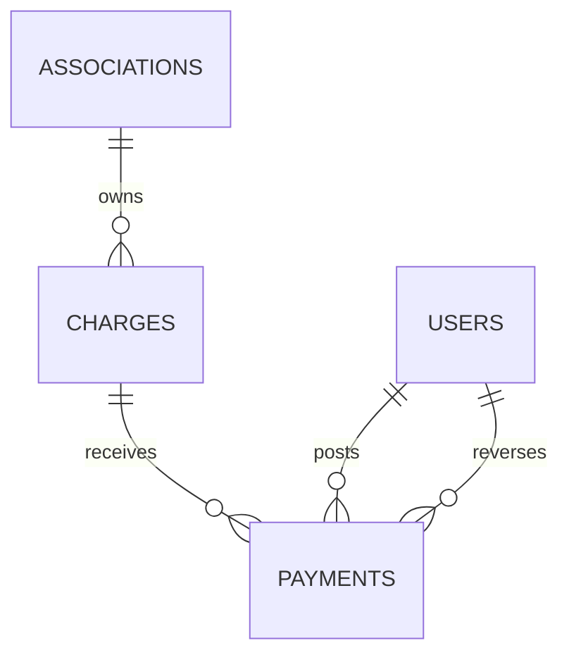
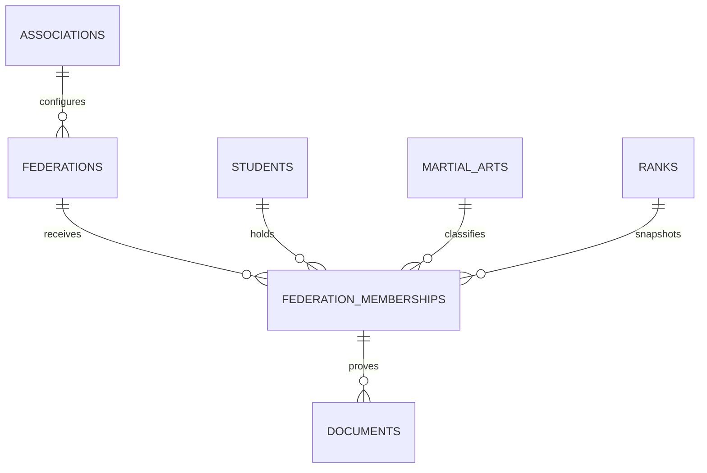
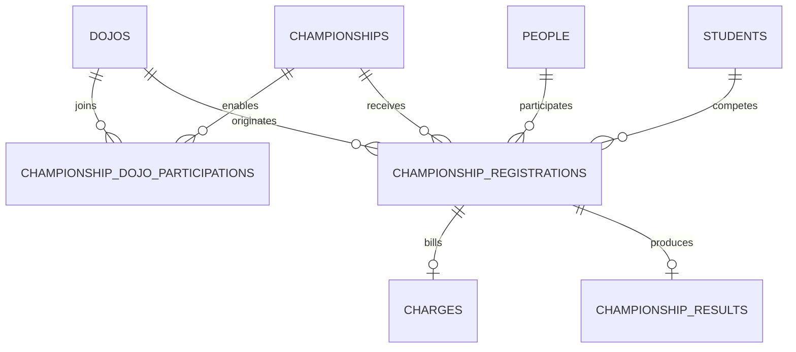

# Banco de dados

## Convenções

- tabelas e colunas em `snake_case`;
- PK `BIGINT UNSIGNED` em MySQL;
- dinheiro em `DECIMAL(12,2)`;
- datas civis em `DATE` e instantes de negócio em timestamp consistente;
- FKs indexadas e `RESTRICT` como padrão para dados históricos;
- soft delete somente em cadastro que possa ser inativado;
- JSON apenas para contexto variável, com minimização de dados pessoais.

## Histórico de migrations

| Faixa | Responsabilidade principal |
|---|---|
| `000000`–`000004` | organização, autenticação/RBAC/auditoria e dojos |
| `000005`–`000008` | cadastro esportivo, turmas, aulas/presenças e documentos privados |
| `000009`–`000012` | planos/benefícios, vencimento, cobranças e pagamentos |
| `000013`–`000015` | federações, campeonatos, notificações e escopo de dashboard |
| `000016`–`000019` | acesso operacional, cadastro direto, convites e visitantes |
| `000020`–`000021` | importação assistida e retenção de arquivos/payloads |
| `000022` | meta de 4/8 próximas aulas |
| `000023` | origem financeira por dojo e participação dojo–campeonato |

Os nomes completos em `database/migrations/` são a fonte canônica. Uma mudança deve acrescentar nova migration e analisar todas as anteriores que tocaram a tabela; nunca compacte o histórico de uma instalação existente.

## Fundação

CPF e CNPJ são armazenados somente com dígitos e são únicos quando informados. E-mail de login é normalizado em minúsculas. Auditoria não possui fluxo normal de update/delete.

`dojos.code` é único por associação. Pessoas permanecem globais e são vinculadas por `association_person_roles`, inicialmente com o tipo técnico `registered_person`; esse vínculo não concede acesso nem perfil esportivo. Consulte `modules/organization-people.md` para invariantes e mapa do código. `people.photo_path` guarda a base dos arquivos da foto no disco privado (`photos/{person}/{uuid}`, sufixos `-thumb.jpg` e `-medium.jpg`); nulo quando não há foto.

## Cadastro esportivo

O ponteiro de graduação atual nunca substitui `student_rank_history`. O mesmo vale para `primary_dojo_id` e `student_dojo_history`. Consulte `modules/sports-registry.md`.

Horários de turma são versionados por `valid_from/valid_until`; uma edição nunca altera a linha histórica. Matrículas são períodos e a ausência de índice parcial compatível entre SQLite/MySQL é compensada por validação transacional com bloqueio da turma, além da chave única por turma, aluno e início.

`class_groups.future_session_target` guarda somente 4 ou 8 (padrão 8). A aplicação valida o domínio e bloqueia a turma antes de contar/criar ocorrências. `class_sessions` continua sendo a fonte de verdade; a meta não é cache, não limita histórico e não autoriza excluir excesso.

`class_enrollments` não é apagada: encerrar grava `status=ended`, `end_date` e `exit_reason`, e a chamada considera a matrícula até o término. `class_group_teachers` guarda os professores auxiliares por período (`role_type=assistant`), encerrados por `end_date`.

`class_session_visitors` possui unicidade por aula/aluno e materializa associação, dojo anfitrião, autor, revogação e estado sem criar matrícula. `attendance.participation_type` preserva a proveniência regular/visitante. A FK histórica é restritiva; visita é revogada logicamente. Não existe relação dessa tabela com planos, cobranças ou pagamentos.

## Escopo operacional

`dojo_role_assignments` mantém concessão de conta/papel por associação, dojo e período, com revogação lógica e ator. `teacher_association_memberships` representa o cadastro institucional do professor; `dojo_teacher_assignments`, sua atuação local por período. Nenhuma dessas tabelas cria conta ou substitui `user_roles`, `teacher_profiles` ou `class_group_teachers`. A unicidade protege replay com o mesmo início; sobreposição é recusada sob lock pelo serviço de domínio.

## Cadastro direto

`registration_counters` mantém a próxima sequência por associação e tipo, sempre sob transação e lock. A matrícula gerada também é conferida contra linhas legadas antes do uso. `direct_registration_requests` possui unicidade por associação, operação e UUID; guarda somente referência do resultado e do documento, nunca payload pessoal. A repetição concluída devolve o mesmo aluno/professor.

## Convites de professor

`teacher_invitations` liga associação, perfil, conta e emissor. `token_hash` é único e valida o segredo sem armazená-lo em texto puro; `encrypted_token` existe somente enquanto a entrega aguarda e usa o cast cifrado do Laravel. Estado do convite e estado de transporte são separados. Aceite/recusa/revogação preservam histórico e descartam a cópia cifrada. Expiração é derivada de `expires_at`; reenvio cria uma nova linha e revoga a anterior.

Não há FK que transforme convite em atuação local. `teacher_account` concede somente dashboard; acesso ao dojo continua em `dojo_role_assignments` e `dojo_teacher_assignments`.

## Documentos

`document_types` pode ser global ou próprio da associação. `documents` guarda somente metadados e caminho privado; o binário não entra no banco. O serviço sempre materializa `person_id` e valida a coerência com `student_id`, `teacher_profile_id`, `student_guardian_id` ou `federation_membership_id` e com a associação. A exclusão é lógica. O estado de vencimento é derivado de `expiration_date`, sem atualização destrutiva de histórico.

## Planos e benefícios

`financial_settings` guarda política de vencimento e feriados por associação. `financial_plans` é catálogo versionado por vigência; `student_plans.base_amount` preserva o snapshot atribuído ao aluno e `student_plans.dojo_id` fixa a unidade de origem. Novos vínculos exigem origem; linhas legadas nulas ficam fora da geração até migração inequívoca. `discounts` e `gratuity_requests` possuem período, decisões nominais e estados controlados pelos serviços. Sobreposição é impedida sob lock por aluno/dojo, pois índices parciais não são portáveis entre SQLite e MySQL.

`charges` centraliza obrigações. A unicidade de origem, ID de origem e competência sustenta idempotência; JSON guarda snapshots explicáveis, não a fonte de verdade do saldo. Valores consultáveis permanecem em colunas `DECIMAL`. Para `monthly_fee`, `source_id` referencia logicamente `student_plans.id`; a FK não é física porque outras origens usarão tabelas distintas.

`payments` pertence simultaneamente à associação e à cobrança. A chave `(association_id, idempotency_key)` é única; `request_hash` comprova que uma repetição possui os mesmos dados. Pagamentos estornados permanecem na tabela. O saldo da cobrança é sempre derivável pela soma de `payments.amount` com `status = valid`.

## Federações

`federations` pertence à associação. `federation_memberships` materializa associação, aluno, federação, modalidade, graduação e período; a chave única por aluno/federação/modalidade/ano impede sobrescrita acidental. `rank_id` é um snapshot validado contra `student_rank_history`, que continua sendo a origem esportiva. `documents.federation_membership_id` é opcional e não altera a privacidade do arquivo.

## Campeonatos

`championships` define o evento central, janela, modalidade, taxa e papéis. `championship_dojo_participations` registra idempotentemente quais unidades já participam sem copiar o evento. `championship_registrations` materializa pessoa, aluno opcional, dojo de origem, papel, atributos competitivos, taxa congelada, decisão e `charge_id`. A unicidade por campeonato/pessoa/papel impede duplicidade. `championship_results` possui uma linha por inscrição e é a fonte do histórico derivado.

## Próximas revisões

Antes da produção, revisar retenção, backup/restore e os requisitos legais de recibos em `DECISIONS.md`.

## Notificações e escopo de dashboard

`notification_events` guarda o evento canônico e sua chave idempotente por associação. `notifications` materializa uma entrega por evento/usuário/canal e conserva tentativas, falha, envio e leitura. `notification_templates` separa texto de canal; `notification_preferences` usa chave única por usuário/evento. Os índices `notification_delivery_queue_idx` e `notification_inbox_idx` atendem respectivamente cron e caixa interna.

`users.dojo_id` é opcional e referencia o único dojo usado pelo dashboard restrito. Ele não concede acesso a recursos nem substitui as validações dos demais módulos.

## Importação assistida

`import_batches` pertence simultaneamente à associação, ao dojo e ao usuário que enviou o arquivo. A unicidade `(association_id, dojo_id, import_type, file_hash)` impede replay do mesmo conteúdo no mesmo fluxo. O caminho aponta para o disco privado; `file_deleted_at` registra a aplicação da retenção sem remover o histórico.

`import_rows` pertence ao lote, tem linha e hash, payload bruto/normalizado em JSON e referências técnicas opcionais do resultado. A unicidade por lote/linha e os estados persistidos sustentam retomada. `initial_status` preserva o aviso da prévia quando `status` avança para `processed`. Não há FK polimórfica de resultado: a validade é garantida pelo serviço e o histórico não bloqueia retenção dos cadastros de domínio.

## Acompanhamento técnico

`technique_items` guarda a árvore de técnicas por associação e modalidade (`parent_id` aponta para o grupo; `kind` é `group` ou `item`; `knowledge_type` é `theoretical` ou `practical`, herdado do grupo principal; `status` ativo ou inativo, sem exclusão física). O índice `technique_items_tree_index` cobre a leitura por associação, modalidade e grupo.

`rank_curriculum_entries` guarda só os ajustes de cada graduação, únicos por `(association_id, rank_id, technique_item_id)`. `required_level` vai de 2 a 4; `NULL` significa que o item herdado deixa de ser cobrado a partir daquela graduação. O currículo efetivo é calculado pela soma das graduações anteriores da modalidade (ADR-014). As chaves estrangeiras usam `restrictOnDelete`.

`technique_assessments` é só de inclusão: aluno, modalidade, item, nível (1 a 4), professor, dojo, usuário, data da avaliação e observação. O nível atual de um item é o último registro gravado (maior `id`). Índices `technique_assessments_student_item_index` (consulta do aluno) e `technique_assessments_period_index` (painéis por período).

`class_session_techniques` liga aula e item do catálogo, única por `(class_session_id, technique_item_id)`. Desmarcar preenche `removed_at`/`removed_by_user_id`; marcar de novo limpa os campos.

`progression_settings` tem uma linha por associação (perguntas por quiz, padrão 10; nota mínima da prova oficial, padrão 70; semanas para o lembrete de avaliação, padrão 8). Sem linha, valem os padrões de `ProgressionSetting::DEFAULTS`.

`quiz_questions` (graduação, item teórico opcional, enunciado, explicação, situação) e `quiz_question_options` (texto, `is_correct`, ordem) formam o banco de perguntas. `quiz_releases` guarda a liberação da prova oficial pelo professor (`open`, `used` ou `cancelled`). `quiz_attempts` guarda cada tentativa (`training` ou `official`), com `quiz_release_id` único (uma tentativa por liberação), nota, nota mínima vigente e aprovação; `quiz_attempt_answers` guarda a ordem sorteada das alternativas (`option_ids` em JSON), a alternativa escolhida e o acerto, única por `(quiz_attempt_id, quiz_question_id)`. Nada disso é apagado.

## Compatibilidade com MySQL 5.7

A hospedagem prevista usa MySQL 5.7 (Percona). Nessa versão, com `explicit_defaults_for_timestamp` desligado (padrão), uma coluna `TIMESTAMP NOT NULL` recebe `DEFAULT CURRENT_TIMESTAMP ON UPDATE CURRENT_TIMESTAMP` ou um default inválido. Por isso, datas obrigatórias de negócio usam `dateTime()` nas migrations, e `timestamp()` fica restrito a colunas anuláveis (`created_at`, `updated_at`, `deleted_at` e similares). Bancos de desenvolvimento criados antes de 12/10/2026 mantêm `TIMESTAMP` nessas colunas, o que é equivalente em MySQL 8. O CI executa a suíte em MySQL 8.4 e 5.7.
