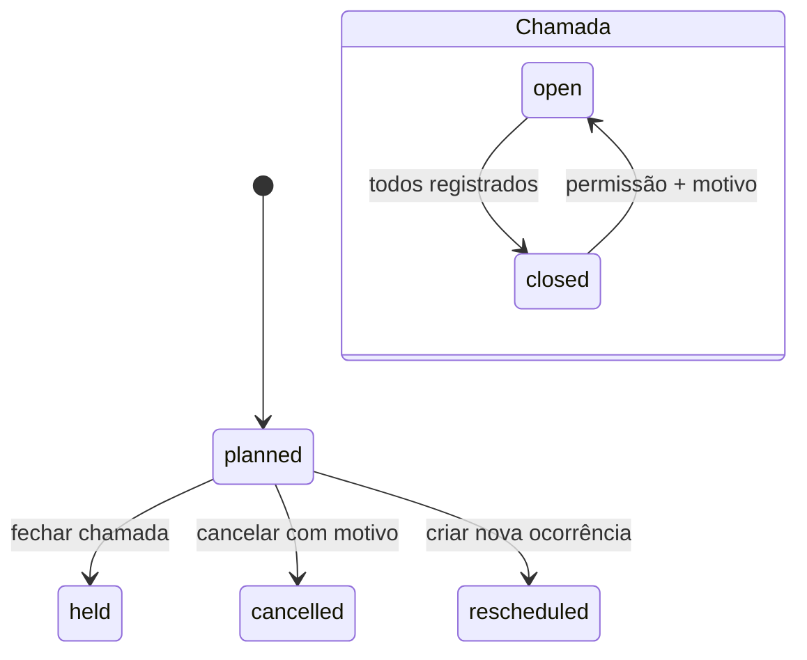

# Aulas e Presença

## Objetivo

Gera ocorrências concretas a partir da agenda versionada, permite cancelamento/reagendamento e registra chamada mobile com fechamento e reabertura controlada.

## Permissões

- `session.view`: agenda e detalhe da aula;
- `session.manage`: cancelar/reagendar aula prevista;
- `attendance.manage`: salvar e finalizar chamada;
- `attendance.reopen`: reabrir chamada finalizada, sempre com motivo.

O escopo é confirmado pela associação da turma da aula. O serviço recarrega a aula sob bloqueio antes de toda transição.

## Entidades e estados

`class_sessions` referencia a versão de `class_schedules` usada na geração. A chave única `(class_group_id, session_date, start_time)` sustenta idempotência. Reagendamento cria nova aula com `rescheduled_from_id` e preserva a original.



A lista de aulas da associação filtra por data, dojo, turma e professor; o professor encontra as aulas previstas ou dadas por ele e as das turmas em que é auxiliar na data. Cada aula mostra o professor previsto com foto, e a chamada mostra a foto de cada aluno.

`attendance` tem uma linha por aula/aluno e registra `participation_type` como `regular` ou `visitor`. O aluno precisa ter matrícula vigente ou visita autorizada na data; matrícula encerrada vale até a data de término. Sem nenhum aluno matriculado, a tela da aula explica o motivo e oferece o link para matricular a quem tem `enrollment.manage`. A chamada só é registrada ou finalizada a partir do dia da aula; antes disso a tela informa a data em que ela abre. Chamada fechada é imutável até reabertura auditada, que pode ser feita pela associação (`attendance.reopen`) ou pelo dojo: o gestor nas aulas do dojo e o professor nas aulas dele. Fechamento exige todos os alunos da lista e materializa a visita como `attended` ou `no_show`.

## Visitante

`class_session_visitors` autoriza um aluno ativo somente para uma aula e dojo anfitrião. Inclusão usa matrícula exata; não há diretório externo. `SessionVisitorService` exige mesma associação, modalidade, idade, responsável legal quando aplicável, vaga e permissão `visitor.manage`. Aluno regularmente matriculado permanece regular e não é duplicado. Revogação é lógica e só ocorre antes de existir presença.

A visita não cria matrícula, vínculo com dojo nem lançamento financeiro. O portal mostra a presença como visita, e os indicadores da aula exibem visitantes separadamente.

## Reposição idempotente

Comando:

```powershell
.\scripts\php.ps1 artisan sigam:sessions:generate --association=9
```

O comando completa a meta de 4 ou 8 aulas de cada turma e ignora as opções legadas `--from`/`--until`. `FutureSessionMaintainer` conta ocorrências futuras pela data/hora, bloqueia a turma, considera as versões `active` e `replaced` dentro da vigência e cria somente o déficit com `insertOrIgnore`. O período de busca é limitado a 366 dias e ao término da turma. Cancelamentos/reagendamentos não são recriados; reduzir a meta não exclui excesso.

A criação da turma e as transições de agenda/chamada executam o mesmo serviço. O scheduler horário recupera qualquer execução interrompida sem worker residente. `SessionGenerator` permanece interno para reconciliação por intervalo da agenda versionada; `generateForGroup` cria aulas passadas de uma turma (ação "Gerar aulas passadas" e importação de presenças), sem duplicar.

## Mapa do código

- migration `2026_08_30_000007_create_sessions_and_attendance_tables.php`;
- models `ClassSession` e `AttendanceRecord`;
- `FutureSessionMaintainer`, `SessionGenerator`, `AttendanceService` e `SessionVisitorService`;
- `AttendanceController` e requests homônimos;
- comando `GenerateClassSessions`;
- views `resources/views/attendance`, JS progressivo `public/js/attendance.js`;
- testes `tests/Feature/AttendanceTest.php`.

## Auditoria, UX e aceite

Eventos: `attendance.saved|closed|reopened`, `class_session.cancelled|rescheduled` e `class_sessions.replenished`. Motivo de reabertura/cancelamento fica no contexto sem dados pessoais. A tela mobile oferece “marcar todos presentes”, exceções em selects grandes e ações persistentes de salvar/finalizar.

Aceite: duas gerações não duplicam; matrícula ou visita é revalidada; associação diferente é recusada; visitante não gera cobrança; chamada incompleta não fecha; fechada não muda; reabertura exige permissão/motivo; reagendamento preserva original; suíte aprovada em SQLite/MySQL.
