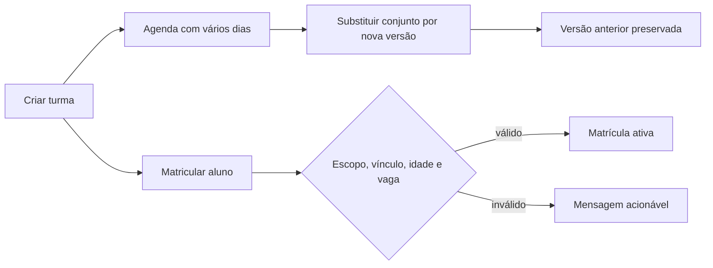

# Turmas, Horários e Matrículas

## Objetivo e escopo

Gerencia programações recorrentes (`class_groups`), versões de horário (`class_schedules`) e períodos de matrícula (`class_enrollments`). Ocorrências concretas e chamada são tratadas no módulo de Aulas/Presença.

## Permissões

- `class.view`: lista e detalhe;
- `class.manage`: criação e substituição de horário;
- `enrollment.manage`: matrícula de aluno.

O escopo vem da associação da rota. `ClassGroupController` confirma a associação do grupo e do horário; `ClassGroupService` revalida dojo, modalidade, professor e aluno.

## Invariantes

- dojo pertence à associação e está ativo;
- modalidade é global ou pertence à associação e está ativa;
- professor, quando informado, pertence à associação e possui habilitação ativa na modalidade;
- uma turma possui de um a sete dias no conjunto semanal; cada dia/horário é uma linha;
- uma turma mantém 4 ou 8 próximas aulas, com padrão 8, contando todos os dias em conjunto;
- alteração de agenda encerra todas as linhas atuais no dia anterior à nova vigência e cria outro conjunto;
- término posterior ao início, dia único no conjunto e conflito de horário do professor são validados;
- aulas futuras sem histórico são reconciliadas; aulas realizadas, com presença ou exceção manual são preservadas;
- aluno precisa estar ativo, vinculado ao dojo e à modalidade na data da matrícula;
- idade é calculada na data inicial e respeita os limites da turma;
- matrícula ativa não se sobrepõe e capacidade é verificada sob `lockForUpdate`;
- turma fora da vigência não recebe matrícula.

## Fluxos

## Mapa do código

- migrations `2026_08_30_000006_create_class_management_tables.php` e `2026_10_11_000022_add_future_session_target_to_class_groups.php`;
- models `ClassGroup`, `ClassSchedule`, `ClassEnrollment`;
- serviços `app/Services/Classes/ClassGroupService.php` e `app/Services/Attendance/FutureSessionMaintainer.php`;
- controller e requests em `app/Http/Controllers/Classes` e `app/Http/Requests/Classes`;
- views em `resources/views/classes`;
- testes em `tests/Feature/ClassManagementTest.php`, `Sprint20Test.php` e `Sprint20ConcurrencyTest.php`.

## Auditoria, UX e aceite

Eventos: `class_group.created`, `class_group.future_session_target_updated`, `class_schedule.replaced`, `class_schedule.set_replaced`, `class_enrollment.created`. A criação usa horário comum por padrão e opção progressiva para horários diferentes. A ficha mostra a agenda atual, permite escolher 4/8 e atualizar as próximas aulas sem apagar excesso ou histórico.

Aceite: três dias geram ocorrências cronológicas; criação completa a meta 4/8; mudança futura não sobrescreve agenda ou chamada anterior; conflito de professor é recusado; matrícula inválida não persiste; capacidade é protegida na transação; recursos externos ao escopo não são aceitos; SQLite e MySQL aprovam a suíte.
