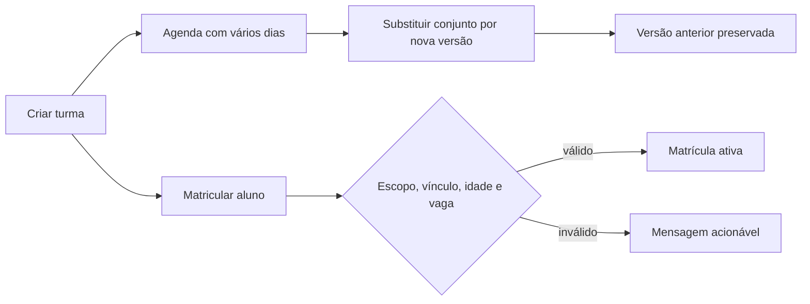

# Turmas, Horários e Matrículas

## Objetivo e escopo

Gerencia programações recorrentes (`class_groups`), versões de horário (`class_schedules`) e períodos de matrícula (`class_enrollments`). Ocorrências concretas e chamada são tratadas no módulo de Aulas/Presença.

## Permissões

- `class.view`: lista e detalhe;
- `class.manage`: criação, edição, substituição de horário e professores auxiliares;
- `enrollment.manage`: matrícula e encerramento de matrícula.

Há dois contextos (ADR-006). Na associação, o escopo vem da rota e `ClassGroupController` confirma a associação do grupo e do horário. No dojo, `DojoClassController` exige concessão vigente (`OperationalScope::canDojo`) e que a turma seja da unidade da rota; o gestor do dojo tem `class.manage` e `enrollment.manage`, e o professor só vê as turmas em que dá aula. `ClassGroupService` revalida dojo, modalidade, professor e aluno nos dois casos.

## Turma no dojo

`/operacao/dojos/{dojo}/turmas/{turma}` reúne Alunos (matriculados, encerrados, matricular e encerrar), Professores (principal e auxiliares), Horários (agenda vigente e substituição) e Aulas (próximas e anteriores, com link para a chamada). A ficha do aluno na associação mostra as turmas dele, e o cadastro direto pode matricular em turmas do dojo escolhido quando o aluno é ativado.

## Invariantes

- dojo pertence à associação e está ativo;
- modalidade é global ou pertence à associação e está ativa;
- professor, quando informado, pertence à associação e possui habilitação ativa na modalidade;
- uma turma possui de um a sete dias no conjunto semanal; cada dia/horário é uma linha;
- uma turma mantém 4 ou 8 próximas aulas, com padrão 8, contando todos os dias em conjunto;
- aulas passadas (histórico e migração) são geradas por período em "Gerar aulas passadas" (`ClassGroupService::generatePastSessions`, até ontem); data inicial anterior ao início da turma recua o início da turma e dos horários iniciais, com auditoria;
- alteração de agenda encerra todas as linhas atuais no dia anterior à nova vigência e cria outro conjunto;
- término posterior ao início, dia único no conjunto e conflito de horário do professor são validados;
- aulas futuras sem histórico são reconciliadas; aulas realizadas, com presença ou exceção manual são preservadas;
- aluno precisa estar ativo, vinculado ao dojo e à modalidade na data da matrícula;
- idade é calculada na data inicial e respeita os limites da turma;
- matrícula ativa não se sobrepõe e capacidade é verificada sob `lockForUpdate`;
- turma fora da vigência não recebe matrícula;
- data de nascimento só é exigida quando a turma tem faixa etária;
- edição não reduz a capacidade abaixo das matrículas ativas nem aceita término anterior ao início;
- trocar o professor principal confere conflito de agenda e atualiza os horários dele e as aulas futuras abertas, sem presença, sem professor previsto ou com o anterior;
- término ou inativação cancela as aulas futuras abertas e sem presença a partir do dia seguinte (inativar: a partir de amanhã) e é recusado se já houver chamada depois disso;
- encerrar matrícula grava `status=ended`, `end_date` e `exit_reason`; a data fica entre o início e hoje e não pode ser anterior a uma presença registrada. O roster usa `ClassEnrollment::coveringDate`, então a matrícula encerrada continua nas chamadas até o término;
- professor auxiliar (`class_group_teachers`, `role_type=assistant`) precisa estar ativo na associação, habilitado na modalidade, com vínculo vigente com o dojo, não ser o principal e não ter período sobreposto na mesma turma; o encerramento é lógico por `end_date`. Quando um auxiliar é escolhido como principal, a designação de auxiliar é encerrada no dia anterior (ou no próprio início, se for futura), preservando o acesso às chamadas anteriores.

## Fluxos

## Mapa do código

- migrations `2026_08_30_000006_create_class_management_tables.php` e `2026_10_11_000022_add_future_session_target_to_class_groups.php`;
- models `ClassGroup`, `ClassSchedule`, `ClassEnrollment`, `ClassGroupTeacher`;
- serviços `app/Services/Classes/ClassGroupService.php` e `app/Services/Attendance/FutureSessionMaintainer.php`;
- controller e requests em `app/Http/Controllers/Classes` e `app/Http/Requests/Classes`;
- views em `resources/views/classes` (agenda em `classes/partials/schedule.blade.php`) e `resources/views/operation/class*.blade.php`;
- testes em `tests/Feature/ClassManagementTest.php`, `Sprint20Test.php`, `Sprint20ConcurrencyTest.php` e `DojoClassHubTest.php`.

## Auditoria, UX e aceite

Eventos: `class_group.created`, `class_group.future_session_target_updated`, `class_schedule.replaced`, `class_schedule.set_replaced`, `class_enrollment.created`, `class_group.updated`, `class_enrollment.ended`, `class_group_teacher.assigned`, `class_group_teacher.ended`. A criação usa horário comum por padrão e opção progressiva para horários diferentes. A ficha mostra a agenda atual, permite escolher 4/8 e atualizar as próximas aulas sem apagar excesso ou histórico.

Aceite: três dias geram ocorrências cronológicas; criação completa a meta 4/8; mudança futura não sobrescreve agenda ou chamada anterior; conflito de professor é recusado; matrícula inválida não persiste; capacidade é protegida na transação; recursos externos ao escopo não são aceitos; SQLite e MySQL aprovam a suíte.
