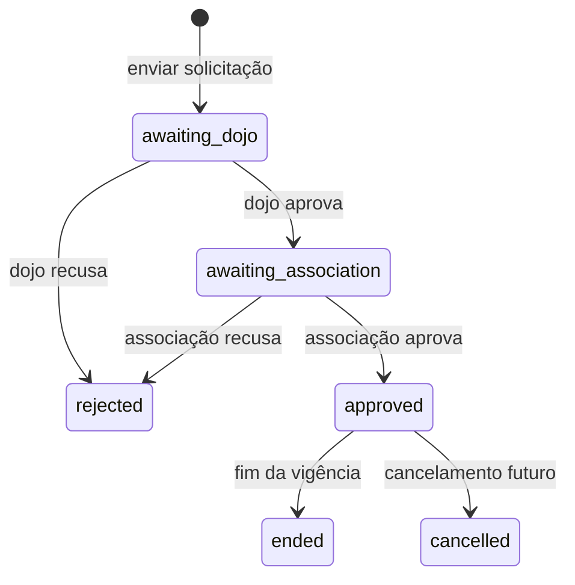

# Planos financeiros e benefícios

## Responsabilidade

O módulo financeiro configura regras de vencimento, planos, vínculos de alunos, descontos, gratuidades e simulação explicável. Em conjunto com `recurring-charges.md`, também gera cobranças, recebe pagamentos e preserva estornos. A associação mantém o catálogo; o dojo pode vincular plano e operar obrigações cuja origem persistida seja sua unidade.

## Invariantes

- valores persistidos usam `DECIMAL(12,2)` e cálculos usam BCMath; `float` não participa da regra financeira;
- ao vincular um plano, `student_plans.base_amount` recebe um snapshot do valor. Mudanças futuras no catálogo não alteram o vínculo;
- `student_plans.dojo_id` registra a unidade que administra a obrigação. O vínculo regular nessa unidade é validado na data inicial; `primary_dojo_id` nunca é usado como origem implícita;
- um aluno não pode possuir períodos sobrepostos de plano ativo no mesmo dojo;
- plano restrito a dojo ou modalidade só aceita aluno compatível;
- descontos possuem início e fim e não se sobrepõem no mesmo vínculo;
- por padrão, solicitante e aprovador do desconto são pessoas diferentes; a associação pode desativar essa aprovação;
- gratuidade exige aprovação do dojo e depois da associação, por usuários distintos;
- serviços usam transação, `lockForUpdate`, validação de associação e auditoria com dados minimizados.

## Vencimento — D-06

O dia preferencial aceita 1 a 31. Se não existir na competência, usa o último dia do mês. A associação escolhe manter a data, avançar ao próximo dia útil ou recuar ao anterior. Sábado, domingo e datas ISO cadastradas em `financial_settings.holiday_dates` não são úteis. Data e política são copiadas para o snapshot da cobrança no momento da geração.

## Gratuidade — D-08

`draft` é apenas um estado de edição no navegador e não é persistido pela interface server-side atual. `requested` permanece como termo histórico das especificações; o envio atômico materializa diretamente `awaiting_dojo`. Não há endpoint genérico para atualizar `status`.

## Simulador

Entrada: aluno e competência. O backend encontra plano, benefício vigente e regra de vencimento. Gratuidade aprovada prevalece sobre desconto; desconto percentual é arredondado em duas casas e qualquer desconto é limitado ao valor-base. A resposta mostra linhas explicativas e não grava cobrança.

A mesma classe `FinancialCalculator` é usada pelo simulador e pelo gerador de cobranças, evitando divergência. A cobrança armazena IDs de origem e snapshots de valores, datas e composição.

## Permissões

- `finance.view`: central e simulador;
- `finance.manage`: configurações, planos e vínculos;
- `student_plan.manage`: somente vínculo de plano para aluno do dojo no contexto operacional;
- `discount.manage` / `discount.approve`;
- `gratuity.request`;
- `gratuity.approve_dojo` / `gratuity.approve_association`.

Permissão e associação precisam coincidir. IDs enviados pelo formulário não ampliam o escopo.

## Mapa de código

- migrations: `2026_08_30_000009_create_financial_plans_and_benefits_tables.php`, `000010_add_holidays_to_financial_settings.php` e consolidação local `2026_10_11_000023_consolidate_dojo_operation.php`;
- models: `FinancialSetting`, `FinancialPlan`, `StudentPlan`, `Discount`, `GratuityRequest`;
- serviços: `app/Services/Finance/FinancialBenefitService.php`, `FinancialCalculator.php`;
- entrada HTTP: `app/Http/Requests/Finance/`, `FinanceController`, `resources/views/finance/`;
- apresentação monetária sem float: `app/Support/Money/MoneyFormatter.php`;
- regressão: `tests/Feature/FinancialPlansAndBenefitsTest.php`.

## Limites atuais

Baixa idempotente, estorno e reconciliação seguem D-07 e estão implementados no serviço de pagamentos. Encerramento automático de benefícios vencidos não possui job próprio: simulador e gerador ignoram vigências expiradas sem depender de atualização destrutiva de estado. Relatórios, configuração de catálogo, estorno e aprovação final associativa continuam fora do contexto operacional do dojo.
