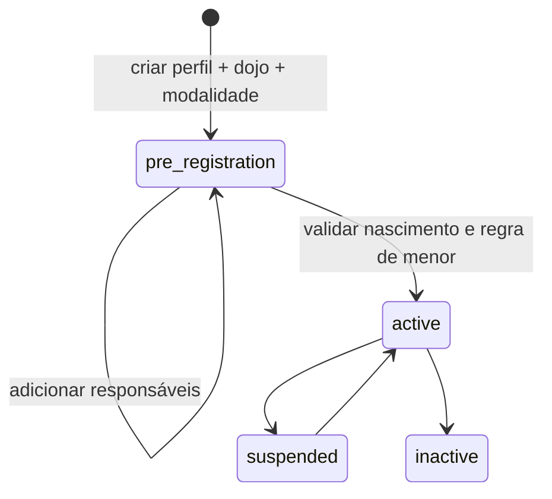

# Cadastro Esportivo

## Objetivo e limites

O módulo transforma uma pessoa nova ou existente em aluno ou professor sem duplicar identidade. Inclui cadastro direto, modalidades configuráveis, graduações ordenadas, pré-cadastro/ativação de aluno, responsáveis, histórico de dojo, vínculo com modalidades, graduação inicial e habilitações de professor. Federação consulta esse histórico somente para validar e congelar a graduação registrada na filiação.

## Permissões e escopo

- `martial_art.view|manage`: catálogo da associação;
- `student.view|manage`: alunos e responsáveis da associação;
- `teacher.view|manage`: professores vinculados por pessoa à associação.

Todas as rotas são aninhadas em `Association`. Controllers validam que os recursos pertencem à associação; serviços revalidam pessoa, dojo, modalidade e graduação antes de escrever. Registros globais de modalidade (`association_id = NULL`) podem ser usados, mas não editados por gestor associativo.

## Entidades e invariantes

- `martial_arts` e `ranks`: graduações nunca são valores fixos no código; nome e ordem são únicos na modalidade.
- `students`: uma pessoa e uma matrícula são únicas por associação. Todo novo aluno começa em `pre_registration`.
- `student_dojo_history`: registra períodos; `students.primary_dojo_id` é somente o ponteiro atual.
- `student_martial_arts`: permite múltiplas modalidades por período e aponta para a graduação atual.
- `student_rank_history`: fato histórico imutável; a graduação inicial recebe origem `initial_registration`.
- `student_guardians`: vários responsáveis por aluno, com funções legal, financeira, principal e de comunicação.
- `teacher_profiles`: perfil único por pessoa, reutilizado entre associações; `teacher_martial_arts` guarda habilitações.

Dojo e pessoa precisam estar ativos e no mesmo escopo do aluno. A graduação precisa pertencer à modalidade. Associação inativa não cria aluno. IDs enviados pelo formulário nunca ampliam acesso.

## Fluxo de aluno

Na entrega atual, a interface executa até `active` e permite adicionar vínculo regular em outro dojo sem duplicar o aluno. Suspensão, transferência e desligamento completos não possuem fluxo próprio na interface atual. Uma futura implementação deve criar transições auditáveis e preservar `exit_date`/`exit_reason`, sem sobrescrever ou excluir períodos anteriores.

Quando `associations.requires_minor_guardian = true`, ativação de menor de 18 anos exige responsável legal vigente. Data de nascimento ausente sempre bloqueia ativação. Múltiplos dojos/modalidades são permitidos no modelo; um dojo permanece marcado como principal por período.

## Mapa do código

- migration: `2026_08_30_000005_create_sports_registry_tables.php`;
- models: `MartialArt`, `Rank`, `Student*`, `Teacher*`;
- requests: `app/Http/Requests/Sports`;
- controllers: `app/Http/Controllers/Sports`;
- serviços transacionais: `CatalogService`, `StudentService`, `TeacherService`;
- catálogo opcional de templates: `app/Support/Sports/RankTemplateCatalog.php` e `resources/data/rank-templates.json`;
- views: `resources/views/sports`;
- comportamento progressivo do formulário: `public/js/martial-art-templates.js`;
- testes: `tests/Feature/SportsRegistryTest.php`.

## Template de graduações

Na tela de modalidades, o gestor pode começar em branco ou selecionar um template. A seleção apresenta quantidade, escopo e alerta de revisão; preenche nome e descrição como sugestão. O servidor aceita somente chaves do catálogo versionado, deriva os padrões novamente e cria modalidade, graduações e auditoria na mesma transação. Template inválido ou falha em qualquer graduação não deixa catálogo parcial.

`resources/data/rank-templates.json` é a fonte operacional. Os templates são dados opcionais e versionados, não valores fixos do domínio: a modalidade criada continua pertencendo à associação e todas as graduações podem ser alteradas depois. O arquivo `docs/templates/template_carga_graduacoes.xlsx` permanece como material revisável. A aba `Carga` usa os campos atuais (`name`, `display_name`, `sort_order`, `color_name`, `minimum_age`, `minimum_months` e `status`).

O Judô usa como referência o regulamento da CBJ. O Jiu-Jitsu mantém a sequência adulta na carga principal e apresenta a trilha infantil em `Alternativas`, pois o modelo atual aceita apenas uma sequência linear por modalidade. O Karatê usa a sequência Shotokan divulgada pela CBKD somente como referência editável; estilos e federações podem adotar outras cores e critérios.

Nenhum template é aplicado automaticamente e nenhum deles é um seeder. A opção `Começar em branco` preserva o cadastro manual. Antes de selecionar uma referência, a associação deve confirmar a entidade e o estilo adotados. Valores vazios de idade ou tempo mínimo significam requisito não afirmado pelo template, nunca valor zero. Consulte ADR-010.

## Auditoria e privacidade

Eventos atuais: `martial_art.saved`, `rank.saved`, `rank.template_applied`, `student.created`, `student.guardian_added`, `student.activated` e `teacher.saved`. A aplicação de template registra chave, fonte e quantidade, além da criação de cada graduação. Auditoria usa IDs de vínculo e status; não copia nascimento, documentos ou contatos de menor/responsável.

## UX e critérios de aceite

O cadastro direto reúne dados pessoais, dojo/modalidade, responsável e documento opcional em seções numeradas. A matrícula é automática. O operador escolhe salvar pré-cadastro ou concluir; pendências de nascimento/responsável são explicadas. A tela administrativa permite reutilizar pessoa acessível; no dojo, não há lista ampla de outras pessoas. No catálogo, o template é opcional, mostra um resumo antes do envio e preenche campos sem impedir edição; sem JavaScript, o backend ainda usa os padrões do template.

Aceite: catálogo não usa valores hardcoded na regra de domínio; template desconhecido é recusado; criação por template é atômica e auditada; usuário sem `martial_art.manage` não aplica template; aluno gera vínculos históricos em transação; menor não ativa sem responsável legal quando configurado; recursos de outra associação são recusados; professor reutiliza pessoa e aceita múltiplas habilitações; testes passam em SQLite e MySQL.
